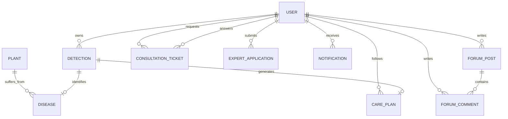

# AGROBLOOM AI — DATABASE SCHEMA & PERSISTENCE DOCUMENTATION
## Mongoose ODM Schemas, Data Modeling, Relationships, and Indexing

**Project:** AgroBloom AI — Advanced Crop and Flower Plant Disease Detection System  
**Academic Level:** Master of Computer Applications (MCA) Major Project  
**Author:** AgroBloom AI Database Engineering Team  
**Date:** October 2026  

---

### 1. Database Overview & Technology Stack

AgroBloom AI utilizes **MongoDB (v7.0+)** paired with **Mongoose ODM** for Node.js. The persistence layer is designed to support high-throughput analytical queries, polymorphic plant/disease metadata, relational user references, and audit timestamps.

- **Database Name:** `agrobloom_ai`
- **Connection URI:** `mongodb://127.0.0.1:27017/agrobloom_ai` (or `mongodb://mongo:27017/agrobloom_ai` in Docker)
- **Primary Design Principles:**
  - Strict type checking and enum enforcement on critical fields.
  - Foreign key references using Mongoose `Schema.Types.ObjectId` with `ref`.
  - Automatic `timestamps: true` creating `createdAt` and `updatedAt`.
  - Sensitive field exclusion (e.g., password hash omitted from user projections).

---

### 2. Entity-Relationship Model (ERD)



---

### 3. Detailed Mongoose Collection Specifications

#### 3.1 `users` Collection (`server/models/user.model.js`)
Stores account credentials, profile telemetry, language preferences, and authorization roles.

```javascript
const UserSchema = new mongoose.Schema({
  name: { type: String, required: true, trim: true },
  email: { type: String, required: true, unique: true, lowercase: true, index: true },
  password: { type: String, required: true, select: false },
  role: { 
    type: String, 
    enum: ['farmer', 'agronomist', 'admin'], 
    default: 'farmer', 
    index: true 
  },
  specialization: { type: String, default: '' },
  yearsExperience: { type: Number, default: 0 },
  isVerifiedExpert: { type: Boolean, default: false },
  phone: { type: String, default: '' },
  location: { type: String, default: '' },
  preferredLanguage: { type: String, enum: ['en', 'kn', 'hi'], default: 'en' },
  avatar: { type: String, default: '' }
}, { timestamps: true });
```

#### 3.2 `detections` Collection (`server/models/detection.model.js`)
Persists automated diagnostic results generated via camera, file upload, or offline synchronization.

```javascript
const DetectionSchema = new mongoose.Schema({
  user: { type: mongoose.Schema.Types.ObjectId, ref: 'User', required: true, index: true },
  plantType: { type: String, enum: ['crop', 'flower'], required: true, index: true },
  plantName: { type: String, required: true },
  primaryDisease: { type: String, required: true, index: true },
  confidence: { type: Number, required: true, min: 0, max: 100 },
  severity: { type: String, enum: ['Healthy', 'Low', 'Moderate', 'Severe', 'Unknown'], default: 'Moderate' },
  severityPercentage: { type: Number, default: 0 },
  imageUrl: { type: String, default: '' },
  gradCamUrl: { type: String, default: '' },
  treatmentPlan: {
    organic: [{ type: String }],
    chemical: [{ type: String }],
    preventative: [{ type: String }]
  },
  isOfflineSync: { type: Boolean, default: false },
  detectionSource: { type: String, enum: ['upload', 'camera', 'offline_pwa'], default: 'upload' }
}, { timestamps: true });

// Compound index for user query performance and pagination
DetectionSchema.index({ user: 1, createdAt: -1 });
```

#### 3.3 `plants` and `diseases` Collections
Reference taxonomy stores botanical metadata, scientific classification, pathogen biology, and management regimens.

- **`plants`:** `name`, `scientificName`, `type` (`crop`/`flower`), `description`, `growthStages`, `commonDiseases`.
- **`diseases`:** `name`, `plant`, `pathogenType` (`fungal`, `bacterial`, `viral`, `pest`, `deficiency`), `symptoms`, `biologicalControl`, `chemicalControl`, `preventionMeasures`, `academicReferences`.

#### 3.4 `careplans` and `reminders` Collections
Enables longitudinal crop recovery tracking, personalized recovery milestones, and agricultural task checklists.

- **`careplans`:** `user`, `detection`, `plantName`, `diseaseName`, `currentHealthStatus` (`declining`, `stable`, `improving`, `recovered`), `checklistTasks` (`[{ task: String, dueDate: Date, completed: Boolean }]`), `recoveryTimeline`.
- **`reminders`:** `user`, `carePlan`, `title`, `frequency`, `nextDue`, `isCompleted`.

#### 3.5 `forumposts` and `forumcomments` Collections
Facilitates grower-to-grower agricultural peer consultation, symptom Q&A, and agronomist verification.

- **`forumposts`:** `author` (`ref: User`), `title`, `content`, `category`, `cropType`, `images`, `upvotes` (`[{ type: ObjectId, ref: 'User' }]`), `isSolved`, `acceptedAnswer`.
- **`forumcomments`:** `post` (`ref: ForumPost`), `author` (`ref: User`), `content`, `parentComment` (self-referential for threaded nested replies), `isExpertAnswer`.

#### 3.6 `consultationtickets` and `expertapplications` Collections
Structured advisory workflows connecting certified plant pathologists with growers.

- **`consultationtickets`:** `farmer` (`ref: User`), `assignedExpert` (`ref: User`), `detection` (`ref: Detection`), `title`, `description`, `status` (`open`, `under_review`, `prescribed`, `closed`), `messages` (`[{ sender, message, attachments, timestamp }]`), `formalPrescription`.
- **`expertapplications`:** `applicant` (`ref: User`), `institution`, `degreeCertificateUrl`, `licenseNumber`, `yearsOfPractice`, `status` (`pending`, `approved`, `rejected`), `reviewedBy` (`ref: User`).

---

### 4. Indexing & Optimization Strategy

1. **Unique Email Index:** `{ email: 1 }` with `{ unique: true }` ensures zero duplicate user accounts.
2. **User History Reverse Sort:** `{ user: 1, createdAt: -1 }` on `detections` guarantees sub-5ms query response times when rendering paginated farmer history timelines.
3. **Forum Search Text Index:** Compound text index on `forumposts`: `{ title: 'text', content: 'text', cropType: 'text' }` for lightning-fast keyword searches.
4. **Offline Duplicate Prevention Index:** Sparse index on `detections`: `{ user: 1, createdAt: 1, primaryDisease: 1 }`.

