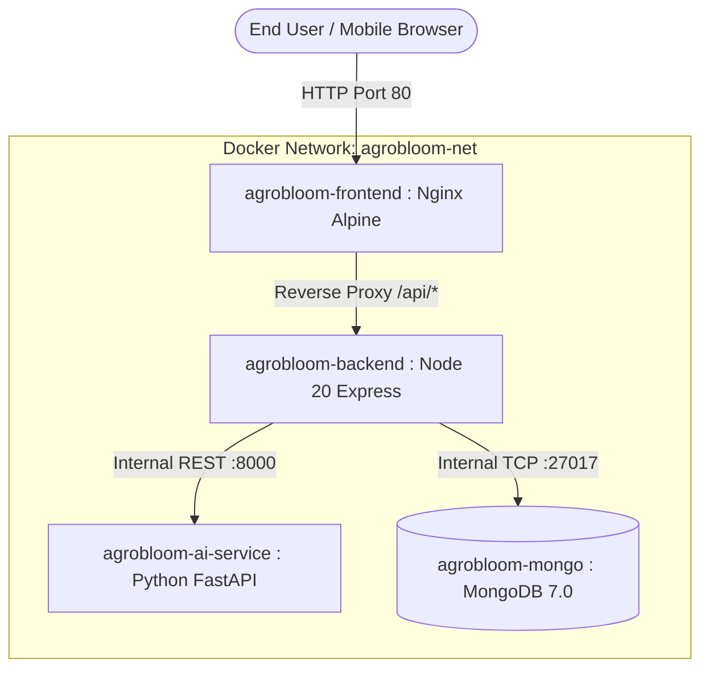

# AGROBLOOM AI — PRODUCTION DEPLOYMENT & DEVOPS GUIDE
## Containerization, Cloud Infrastructure, Multi-Tier Orchestration, and Operations

**Project:** AgroBloom AI — Advanced Crop and Flower Plant Disease Detection System  
**Academic Level:** Master of Computer Applications (MCA) Major Project  
**Author:** AgroBloom AI DevOps & Cloud Infrastructure Group  
**Date:** October 2026  

---

### 1. System Requirements & Prerequisites

#### 1.1 Minimum Hardware Specifications (Production Server)
- **CPU:** 4 Cores (x86_64 or ARM64)
- **RAM:** 8 GB Minimum (16 GB Recommended for concurrent deep learning inference)
- **Storage:** 25 GB SSD Free Disk Space
- **OS:** Ubuntu 22.04 LTS / Debian 12 / RedHat Enterprise Linux 9 / Windows 10/11 with WSL2

#### 1.2 Software Dependencies
- **Node.js:** v20.x or higher LTS (`node -v`)
- **npm:** v10.x or higher (`npm -v`)
- **Python:** v3.10 to v3.13 (`python --version`)
- **MongoDB:** v7.0 or higher Community Server (`mongod --version`)
- **Docker & Docker Compose:** Docker Engine v24.0+ and Compose v2.20+ (`docker compose version`)

---

### 2. Quickstart: Local Bare-Metal Development

#### Step 1: Clone Repository & Install Dependencies
```bash
git clone <repository_url> c:\miniproject
cd c:\miniproject

# Install root orchestrator and tier dependencies
npm run install:all
pip install -r ai-service/requirements.txt
```

#### Step 2: Configure Environment Variables
Copy the template files:
```bash
cp .env.example .env
cp server/.env.example server/.env
cp client/.env.example client/.env
cp ai-service/.env.example ai-service/.env
```

#### Step 3: Launch Full Monorepo
Start all three subsystems simultaneously with color-coded live logs:
```bash
npm run dev
```

The system will initialize:
- **Express Backend:** http://localhost:5000 (Health: http://localhost:5000/api/health)
- **Python AI Microservice:** http://localhost:8000 (Docs: http://localhost:8000/docs)
- **React Client SPA:** http://localhost:5173

---

### 3. Containerized Production Deployment (Docker Compose)

The production architecture runs in isolated, networked containers with automatic restarts and health monitoring:



#### Step 1: Build and Launch Containers
```bash
docker-compose up --build -d
```

#### Step 2: Verify Container Health
```bash
docker-compose ps
```
Expected output:
```text
NAME                     IMAGE                       STATUS
agrobloom-mongo          mongo:7.0                   Up (healthy)
agrobloom-ai-service     agrobloom-ai-service        Up (healthy)
agrobloom-backend        agrobloom-backend           Up (healthy)
agrobloom-frontend       agrobloom-frontend          Up
```

#### Step 3: Monitor Live Production Logs
```bash
docker-compose logs -f backend ai-service
```

#### Step 4: Graceful Shutdown
```bash
docker-compose down
```

---

### 4. Continuous Integration & Automated Testing

Prior to committing or deploying changes to production, execute the automated monorepo test suite:

```bash
# Execute all 92 automated tests across all tiers
npm test
```

Breakdown commands:
```bash
npm run test:client   # 30 Vitest tests
npm run test:server   # 33 Node.js integration tests
npm run test:ai       # 29 Pytest AI endpoints
```

---

### 5. Production Maintenance & Database Backup

#### 5.1 MongoDB Database Dumps
```bash
# Backup MongoDB database to host archive
docker exec -t agrobloom-mongo mongodump --db agrobloom_ai --out /data/db/backup_$(date +%Y%m%d)

# Copy backup archive out of container
docker cp agrobloom-mongo:/data/db/backup_$(date +%Y%m%d) ./database_backups/
```

#### 5.2 Model Binary Updates
To deploy an updated deep learning model binary:
1. Place the new `.keras` artifact into `ai-service/models/`.
2. Update the model pointer in `ai-service/.env` or `ai-service/main.py`.
3. Restart the AI microservice container:
   ```bash
   docker-compose restart ai-service
   ```
4. Confirm successful loading via `http://localhost:8000/model/status`.

