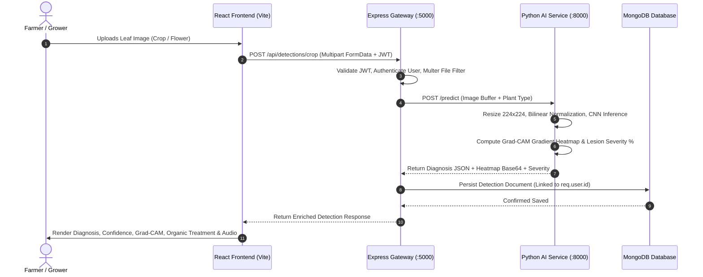

# AGROBLOOM AI — PROJECT ARCHITECTURE SPECIFICATION
## Full-Stack Architectural Blueprint, Data Flow, and System Design

**Project:** AgroBloom AI — Advanced Crop and Flower Plant Disease Detection System  
**Academic Level:** Master of Computer Applications (MCA) Major Project  
**Author:** AgroBloom AI Software Engineering Team  
**Date:** October 2026  

---

### 1. Architectural Philosophy & Overview

AgroBloom AI is engineered as a decoupled, microservice-inspired, full-stack web and mobile progressive web application. The system integrates:
- **Presentation Layer:** React 18 SPA with Tailwind CSS, Lucide icons, responsive mobile sidebar, and PWA capabilities.
- **Application & API Gateway Layer:** Node.js Express RESTful server handling authentication, business logic, community interactions, and database persistence.
- **AI Microservice Layer:** High-performance Python FastAPI service hosting deep learning convolutional neural network models, Grad-CAM visual heatmaps, OpenCV foliar segmentation, and severity calculation.
- **Persistence Layer:** MongoDB NoSQL database structured with normalized Mongoose schemas.
- **Edge Inference Layer:** On-device browser TensorFlow.js engine paired with IndexedDB for offline zero-connectivity field diagnostics.

---

### 2. High-Level System Architecture Diagram

```
+----------------------------------------------------------------------------------------------------+
|                                    PRESENTATION TIER (REACT PWA)                                   |
|                                                                                                    |
|  +---------------------+   +---------------------+   +---------------------+   +----------------+  |
|  | Disease Detectors   |   | Explainable AI View |   | AI Chatbot & Care   |   | Offline Studio |  |
|  | (Crop, Flower, Cam) |   | (Grad-CAM, Segment) |   | (RAG, Care Plans)   |   | (PWA + TF.js)  |  |
|  +---------------------+   +---------------------+   +---------------------+   +----------------+  |
|  | Multilingual Engine |   | Farmer Forum        |   | Expert Consultation |   | Telemetry View |  |
|  | (EN, KN, HI, TTS)   |   | (Threads, Replies)  |   | (Tickets, Agronomy) |   | (Benchmarks)   |  |
|  +---------------------+   +---------------------+   +---------------------+   +----------------+  |
+----------------------------------------------------------------------------------------------------+
                   |                                                                  |
                   | (HTTP REST / JSON / Multipart)                                   | (On-Device Local)
                   v                                                                  v
+-------------------------------------------------------+               +----------------------------+
|        APPLICATION & GATEWAY TIER (NODE.JS EXPRESS)   |               |   IndexedDB Local Store    |
|                                                       |               |   (AgroBloomOfflineDB)     |
|  - JWT Authentication & RBAC (Farmer/Agronomist/Admin)|               +----------------------------+
|  - Rate Limiting, Helmet, Multer File Validation     |                              ^
|  - PDF Pathology Report Generation (PDFKit)           |                              |
|  - Offline Record Batch Synchronization Handler       |------------------------------+ (When Online)
|  - Reverse Proxy to Python AI Deep Learning Engine    |
+-------------------------------------------------------+
        |                                       |
        | (Mongoose ODM)                        | (Internal HTTP Proxy: Port 8000)
        v                                       v
+-----------------------------+     +-------------------------------------------------------+
|   DATABASE TIER (MONGODB)   |     |      AI COMPUTATIONAL MICROSERVICE (PYTHON FASTAPI)   |
|                             |     |                                                       |
|  - Users & Profiles         |     |  - Preprocessing & Bilinear Foliar Normalization      |
|  - Detections & Reports     |     |  - MobileNetV2, EfficientNetB0, ResNet50 Models       |
|  - Plants & Diseases        |     |  - Grad-CAM Heatmap Generation (Last Conv Layer)      |
|  - Care Plans & Reminders   |     |  - HSV Foliar Lesion Color Segmentation & Severity %  |
|  - Forum Posts & Comments   |     |  - RAG Agronomic Knowledge Retrieval Engine           |
|  - Consultation Tickets     |     |  - Multi-Architecture Empirical Benchmarking API      |
+-----------------------------+     +-------------------------------------------------------+
```

---

### 3. End-to-End Diagnostic Data Flow



---

### 4. Component Directory Topology

```
c:\miniproject
├── package.json                    # Workspace monorepo definition and root scripts
├── docker-compose.yml              # Complete 4-tier production container orchestration
├── .env.example                    # Global environment variables blueprint
│
├── client/                         # FRONTEND APPLICATION TIER
│   ├── index.html                  # HTML5 entrypoint with PWA links and viewport configuration
│   ├── package.json                # React 18, Vite, Lucide React, Vitest dependencies
│   ├── vite.config.js              # Vite bundler configuration and proxy rules
│   ├── public/
│   │   ├── manifest.json           # Web App Manifest for PWA installation
│   │   └── sw.js                   # Dual-caching Service Worker
│   └── src/
│       ├── App.jsx                 # Primary routing layout and navigation container
│       ├── context/                # Global contexts: AuthContext, ThemeContext, LanguageContext
│       ├── components/             # Reusable UI components (Navbar, Sidebar, Footer, Camera)
│       ├── pages/                  # 14 Production views (CropDetection, ModelBenchmarks, Offline...)
│       ├── services/               # API client, OfflineClassifier, OfflineStorage, VoiceAssistant
│       └── App.test.jsx            # 30 Unit and integration tests
│
├── server/                         # BACKEND REST API GATEWAY TIER
│   ├── server.js                   # Express application bootstrap and route registration
│   ├── package.json                # Express, Mongoose, JWT, Bcryptjs, Multer, Supertest
│   ├── config/                     # Database connection (db.js)
│   ├── middleware/                 # auth.js, upload.js, errorHandler.js
│   ├── models/                     # Mongoose schemas: User, Detection, Plant, Disease, CarePlan...
│   ├── controllers/                # Business logic: auth, detection, forum, consultation...
│   ├── routes/                     # REST routers mounted under /api/*
│   └── tests/api.test.js           # 33 Integration tests executed via Node test runner
│
└── ai-service/                     # AI & DEEP LEARNING MICROSERVICE TIER
    ├── main.py                     # FastAPI application entrypoint and route handlers
    ├── requirements.txt            # TensorFlow, FastAPI, Uvicorn, OpenCV, Scikit-learn
    ├── models/                     # Keras model binaries (.keras) and benchmark metrics (.json/.csv)
    ├── train_and_compare_architectures.py # Unified 3-architecture training & benchmark script
    └── test_ai_endpoints.py        # 29 Pytest test cases covering all diagnostic endpoints
```

