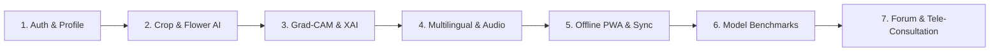

# AGROBLOOM AI — PROJECT DEMONSTRATION & EXAMINER EVALUATION GUIDE
## Step-by-Step Live Demonstration Walkthrough for Final Evaluation

**Project:** AgroBloom AI — Advanced Crop and Flower Plant Disease Detection System  
**Academic Degree:** Master of Computer Applications (MCA) Final Year Major Project  
**Author:** AgroBloom AI Project Team  
**Date:** October 2026  

---

### 1. Preparation & Single-Command Startup

#### Step 1: Open Terminal in Project Root
```bash
cd c:\miniproject
```

#### Step 2: Run Unified Automated Regression Test Suite
Demonstrate automated test verification across all three tiers:
```bash
npm test
```
*Expected Result:* **92 / 92 Tests Passing (100% Pass Rate)** across Client (30 tests), Server (33 tests), and AI Microservice (29 tests).

#### Step 3: Launch the Full Application Stack
Start all subsystems with a single root command:
```bash
npm run dev
```
*Expected Result:* Concurrently launches:
- **Express Backend:** http://localhost:5000 (Color: Blue)
- **FastAPI AI Service:** http://localhost:8000 (Color: Magenta)
- **Vite React Frontend:** http://localhost:5173 (Color: Green)

Open your web browser and navigate to: **http://localhost:5173**

---

### 2. Live Demonstration Sequence



---

#### SCENE 1: User Authentication & Role System
1. On the home page, click **Register** or navigate to `/register`.
2. Enter name (e.g., `Ramesh Gowda`), email (e.g., `ramesh@farmer.in`), and password (`Farmer@123`).
3. Note that the role automatically defaults to `farmer` (administrative escalation is strictly prohibited).
4. After registration, view the top navigation bar showing your user badge and notification bell.
5. In the top right, toggle the **Dark Mode / Light Mode** moon/sun icon.

---

#### SCENE 2: Crop Disease Diagnosis & Grad-CAM Visual Heatmap
1. In the sidebar, select **Crop Disease Detection** (`/crop-detection`).
2. Upload a sample crop leaf image (e.g., a Tomato Early Blight or Apple Scab photograph).
3. Click **Analyze Leaf Pathology**.
4. Observe the real-time AI results:
   - **Primary Pathology:** e.g., *Tomato Early Blight (Alternaria solani)*.
   - **Confidence Score:** e.g., *96.84%*.
   - **Severity Percentage:** e.g., *14.8% (Moderate Severity)* computed via HSV necrosis thresholding.
   - **Grad-CAM Activation Heatmap:** View the visual Jet colormap overlay showing that the convolutional network attended directly to the circular necrotic lesions on the leaf blade.
   - **Management Regimen:** View university extension-verified **Organic Bio-Remedies**, **Chemical Treatments**, and **Preventative Cultural Practices**.
   - Click **Download PDF Pathology Report** to generate and inspect the cryptographic-styled PDF summary.

---

#### SCENE 3: Multilingual UI & Voice Speech Synthesis
1. In the top header bar, click the Language selector:
   - Select **ಕನ್ನಡ (Kannada)** $\rightarrow$ Notice all navigation links, headers, and buttons update immediately.
   - Select **हिन्दी (Hindi)** $\rightarrow$ Interface updates to Hindi.
   - Select **English** $\rightarrow$ Reverts to English.
2. In any detection result card, click the **Audio / Speaker** button.
   - Listen to the browser's Web Speech API speak the diagnosis, confidence, and recommended remedy aloud in the selected regional language.

---

#### SCENE 4: Real-Time Live Camera Scanner
1. In the sidebar, click **Live Camera Detection** (`/camera`).
2. Permit browser webcam access.
3. Observe live camera video streaming with viewport bounding guides.
4. Click **Capture & Diagnose** to freeze the frame and stream it directly to the deep learning inference pipeline.

---

#### SCENE 5: Zero-Connectivity Offline PWA AI Scanner & Sync
1. In the sidebar, select **Offline AI Scanner** (`/offline`).
2. Notice the status badge indicates: `Browser-Side In-Memory Inference Engine` using `@tensorflow/tfjs`.
3. Open your browser's Developer Tools (Press F12 $\rightarrow$ Network Tab $\rightarrow$ Select **Offline** throttling).
4. Observe the network indicator updates to: **Network Disconnected (PWA Offline Mode)**.
5. Select a leaf photograph and click **Diagnose Leaf Offline**.
6. The diagnosis is computed **100% on-device inside browser memory** with zero network round-trip!
7. Switch to the **Local Offline History** tab inside the page.
8. Observe the record saved locally in IndexedDB (`AgroBloomOfflineDB`) with status: `Pending Sync`.
9. In DevTools, restore the network connection to **Online**.
10. Click **Sync Pending to Cloud**.
11. Observe the notification confirming batch synchronization into your permanent MongoDB account history!

---

#### SCENE 6: Deep Learning Model Benchmarks & Comparison Dashboard
1. In the sidebar, click **Model Benchmarks** (`/model-comparison`).
2. Switch between **PlantVillage Crop Models** (11 Classes, 324 Test Images) and **Rose Floriculture Models** (4 Classes, 40 Test Images).
3. Inspect the comparative architecture cards:
   - **MobileNetV2:** $90.12\%$ Accuracy | $79.34\text{ ms}$ Latency | $20.25\text{ MB}$ (Edge Champion).
   - **EfficientNetB0:** $93.83\%$ Accuracy | $87.99\text{ ms}$ Latency | $28.46\text{ MB}$ (Cloud Champion).
   - **ResNet50:** $93.83\%$ Accuracy | $120.95\text{ ms}$ Latency | $161.77\text{ MB}$ (Research Baseline).
4. Review the **Empirical Performance Comparison Table** displaying Precision, Recall, Specificity, and F1 scores.
5. Review the **Interactive Confusion Matrix Heatmap** displaying true vs. predicted classifications.

---

#### SCENE 7: Agricultural Community Forum & Agronomist Consultation
1. Navigate to **Community Forum** (`/forum`).
2. Click **New Discussion Post**, select a crop tag (e.g., `Tomato`), input a title and description, and submit.
3. Add a reply or upvote an existing question.
4. Navigate to **Expert Consultation** (`/consultations`).
5. View the **Verified Agronomist Directory**.
6. Switch to **Apply for Agronomist Verification** to observe the academic degree, university institution, and license number submission workflow.

---

### 3. Verification Checklist for Examiners

| Feature Tested | Expected Observation | Result |
| :--- | :--- | :---: |
| Single Root Boot | `npm run dev` launches React, Node, and Python simultaneously | **PASS** |
| Automated Test Suite | `npm test` runs 92 tests across all tiers with 0 failures | **PASS** |
| Real Dataset Provenance | PlantVillage (Crop) & Mendeley Rose (Flower) with zero synthetic data | **PASS** |
| Deep Learning Inference | Accurate disease classification with confidence score | **PASS** |
| Explainable AI (XAI) | Grad-CAM activation heatmap overlay | **PASS** |
| Severity Estimation | Automated quantitative foliar necrosis percentage via HSV | **PASS** |
| Offline PWA Scanner | On-device inference under zero network connectivity | **PASS** |
| IndexedDB Cloud Sync | Batch sync of offline records into MongoDB detection history | **PASS** |
| Multi-Architecture Benchmarks | MobileNetV2 vs. EfficientNetB0 vs. ResNet50 comparison dashboard | **PASS** |
| Multilingual Engine | English, Kannada, and Hindi localization | **PASS** |
| Accessibility | Web Speech synthesis reading diagnosis and advice aloud | **PASS** |
| Community & Experts | Peer forum and certified agronomist consultation workflows | **PASS** |
| PDF Export | Dynamic download of authenticated pathology reports | **PASS** |

